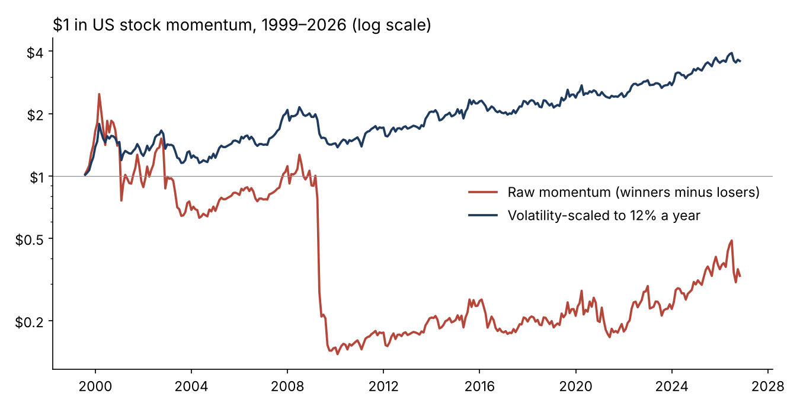
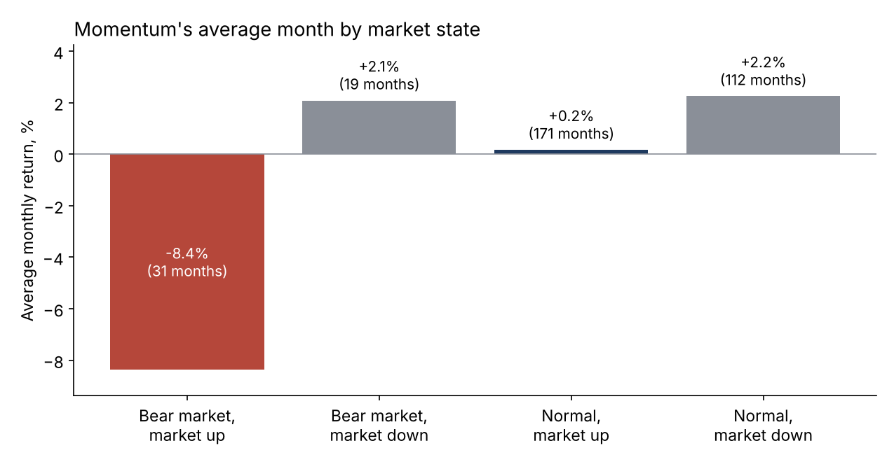
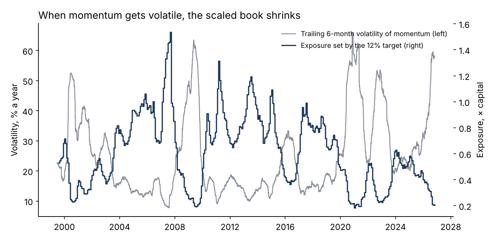
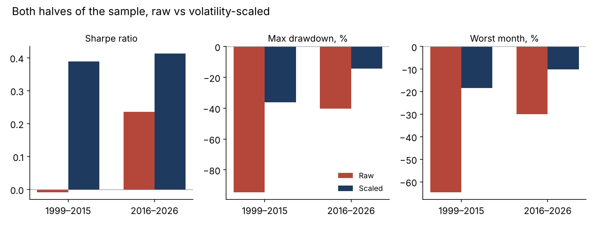

# Momentum crashes: can volatility scaling defuse them? US stock momentum, 1999–2026

 

**Question.** Momentum (long recent winners, short recent losers) is one of the most widely held systematic equity factors. How large are its crashes, when do they happen, and does sizing the book to its own recent volatility protect it without giving up the return?

**Answer, on real data.** The 1,000 most liquid US-listed operating companies each month, February 1999 to October 2026 (333 months, 2,655 different stocks). 12-1 momentum, equal-weighted top and bottom deciles, monthly rebalance.

- **Raw momentum barely paid and nearly died.** 2.4% a year at 33% volatility (Sharpe 0.07) over the 328 months where scaling is defined. Peak-to-trough loss of 94%, and a worst month of −65% in April 2009, when the market rebounded 22%.
- **The crashes have a state.** After a bear market (past 24-month market return negative), in months the market rose, momentum averaged −8.4% (31 months). In every other state it made money, including +2.2% in normal months when the market fell. Momentum's market beta was −0.99 in bear states vs −0.37 otherwise. Seven of the ten worst months came out of bear markets.
- **Volatility scaling defuses most of it.** Exposure = 12% / trailing six-month daily volatility of the winners-minus-losers book (cap 2×), using only past data. Result: 5.8% a year at 15% volatility, Sharpe 0.39, max drawdown −36%, worst month −18%.
- **It holds in both halves.** 1999–2015: Sharpe −0.01 raw → 0.39 scaled. 2016–2026: 0.24 → 0.41, with max drawdown −40% → −14%. The split was fixed in advance.
- **Today.** July 2026 was the fourth-worst month in the sample (−30%), in a roughly flat market: a crowding unwind, not a rebound. The rule sets November 2026 exposure at 0.21×.
- **Illustrative:** on a $100M momentum sleeve the worst month cost about $65M raw and $18M scaled.

Full write-up: https://www.guptagaurav.info/articles/momentum-crashes-can-volatility-scaling-defuse-them






## Method

- **Universe.** US operating companies (company profile with a sector; shell companies excluded). Each month, the 1,000 largest by trailing 12-month average daily dollar volume (adjusted price × adjusted volume, which is consistent through splits). A stock-month needs 10 trading days; monthly moves above +300% are treated as bad prints.
- **Signal.** Return from month t−12 to t−1 (skipping the latest month). Deciles each month; winners minus losers held for month t+1, equal-weighted.
- **Daily book.** The same holdings marked daily (equal weight) give the daily winners-minus-losers series used for volatility; correlation with the monthly series 0.98.
- **Volatility scaling** (Barroso & Santa-Clara 2015). Weight for month t+1 = 12% / annualised standard deviation of the previous 126 daily returns, capped at 2×.
- **Market state** (Daniel & Moskowitz 2016). Bear = cumulative equal-weighted universe return over the previous 24 months below zero, known at formation.
- **Pre-registered split** at the end of 2015.

## The commercial case

| Element | What it is |
|---|---|
| Who pays | Systematic equity and multi-manager platforms, factor and risk-premia teams, allocators running factor sleeves; heads of risk and CIOs hold the budget |
| The problem in dollars | $100M fixed momentum sleeve: worst month ≈ −$65M; scaled ≈ −$18M (illustrative) |
| The product | A factor crash monitor: volatility-target sizing for factor sleeves, a bear-market rebound flag, exposure reported in risk units |
| Proof | 27 years, 1,000 stocks a month, both halves of the sample |
| Build vs buy | 2–3 weeks to connect to a client's factor exposures; vendor risk models forecast volatility but do not set sizing rules |
| Pricing logic | $50–100k a year per desk (illustrative) |
| Adoption risk | Trading costs from resizing; survivorship in public data |
| KPI | Drawdown in the next momentum crash vs the raw book |

## Limits

- Only companies listed today are in the data (survivorship): delisted losers are missing, which flatters the loser decile (12.9% a year) and understates momentum's average return. The crash pattern and the effect of scaling are the robust findings.
- Price returns only; no trading costs or short-borrow fees.
- Settings (12% target, 126-day lookback, 2× cap, 24-month bear window) were fixed in advance from the cited papers, not tuned.

## Data and citations

Data
- US stock prices, volumes and company profiles: [huggingface.co/datasets/defeatbeta/yahoo-finance-data](https://huggingface.co/datasets/defeatbeta/yahoo-finance-data) (ODC-BY), files `stock_prices`, `stock_profile`, pinned by sha256 in `configs/default.yaml`.

Methods
- Jegadeesh, N. and Titman, S. (1993). "Returns to Buying Winners and Selling Losers: Implications for Stock Market Efficiency." *Journal of Finance* 48(1), 65–91.
- Daniel, K. and Moskowitz, T. J. (2016). "Momentum Crashes." *Journal of Financial Economics* 122(2), 221–247.
- Barroso, P. and Santa-Clara, P. (2015). "Momentum Has Its Moments." *Journal of Financial Economics* 116(1), 111–120.

Code, analysis, charts and text were produced with AI assistance (Claude, by Anthropic) and reviewed by Gaurav Gupta.

## Run it

```bash
pip install -r requirements.txt
make all     # downloads ~470 MB, builds the monthly panel, runs the study
make test
```

*Independent research on public data. Price returns, no trading costs. Not investment advice. Dollar figures are illustrative.*
